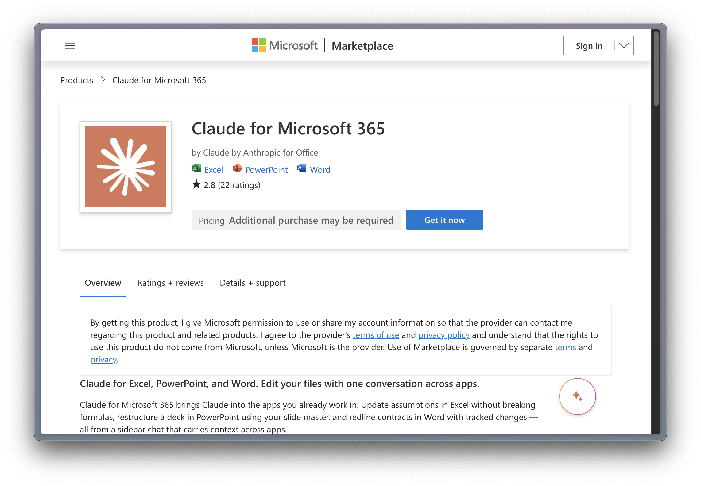
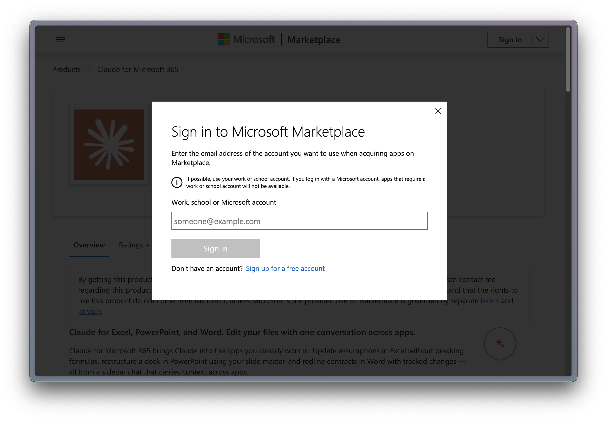
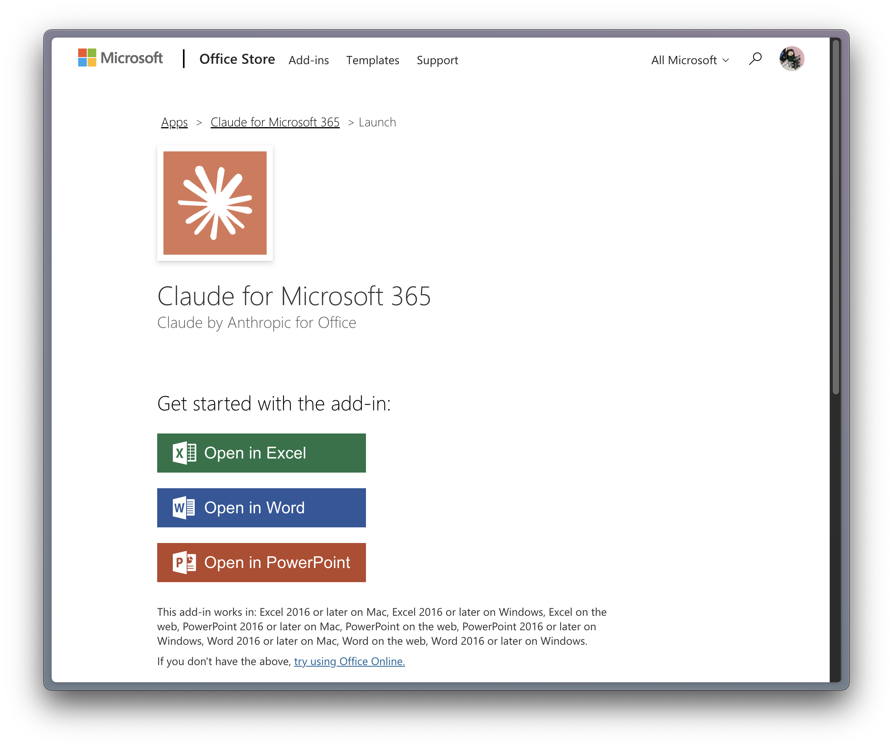
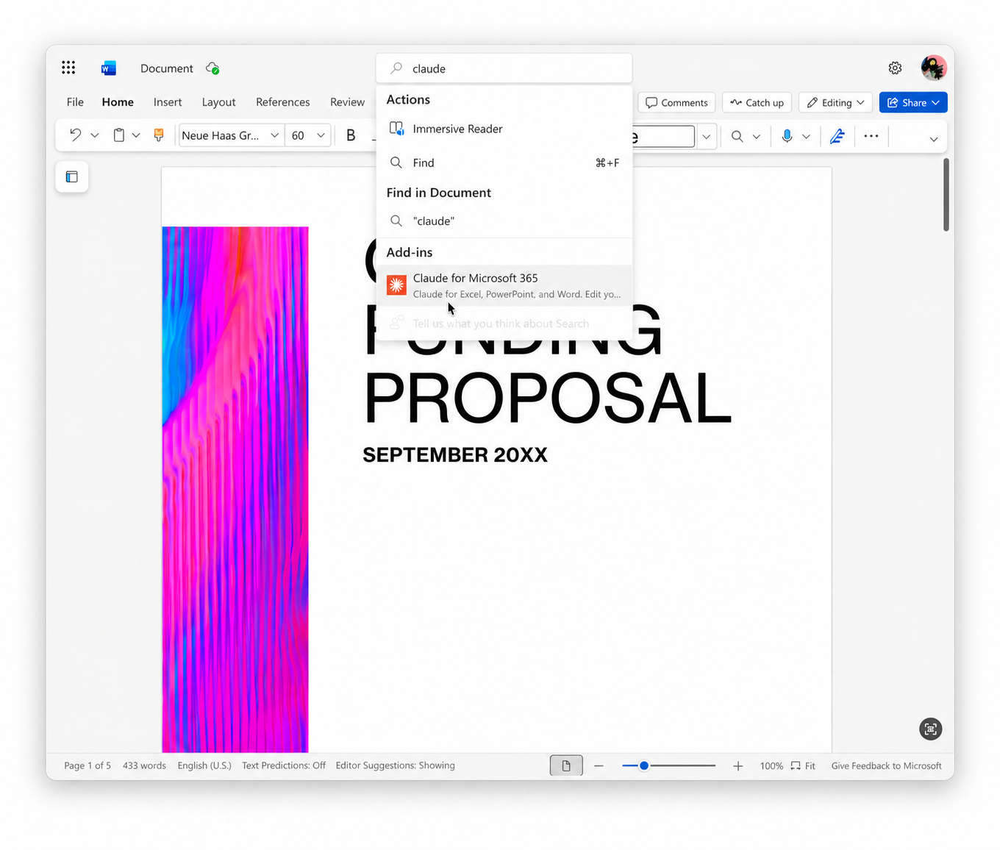
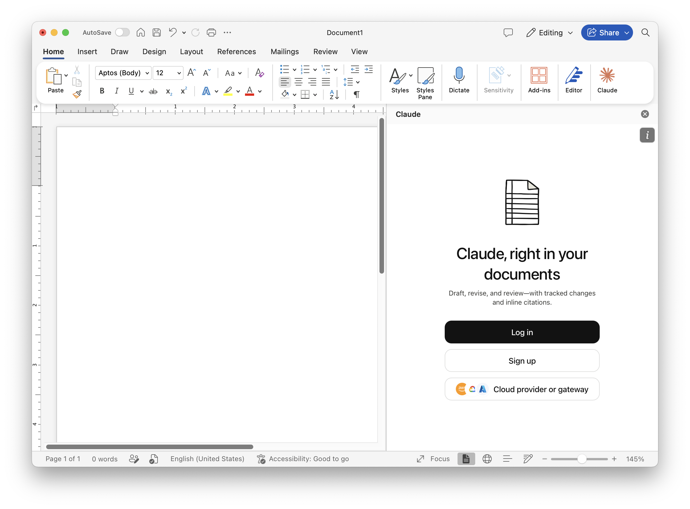
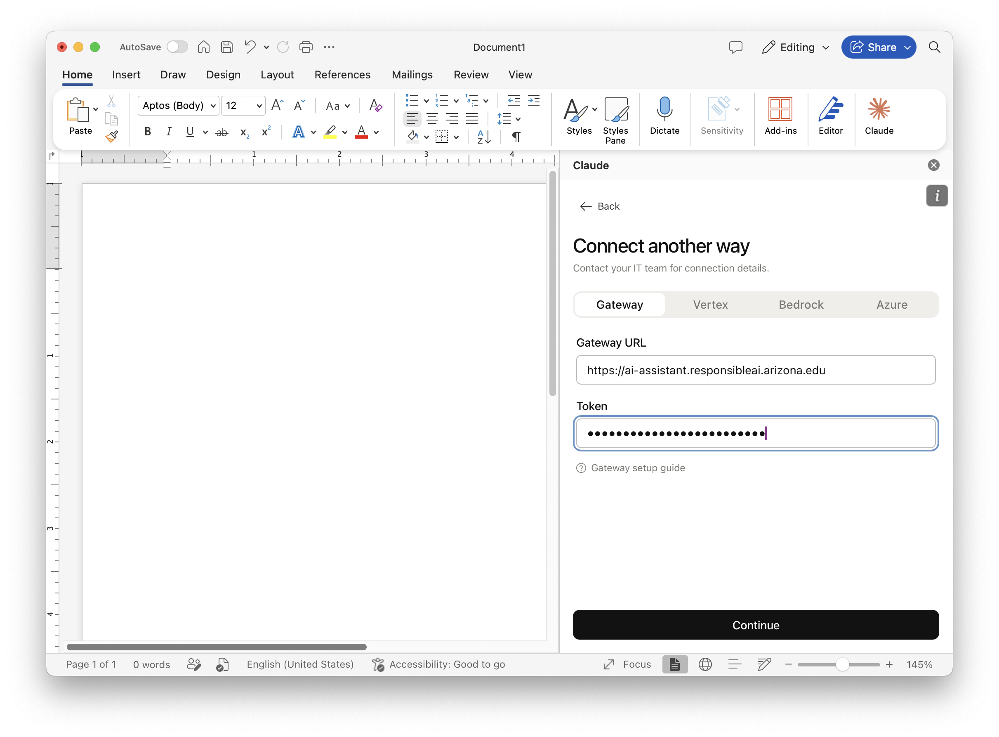
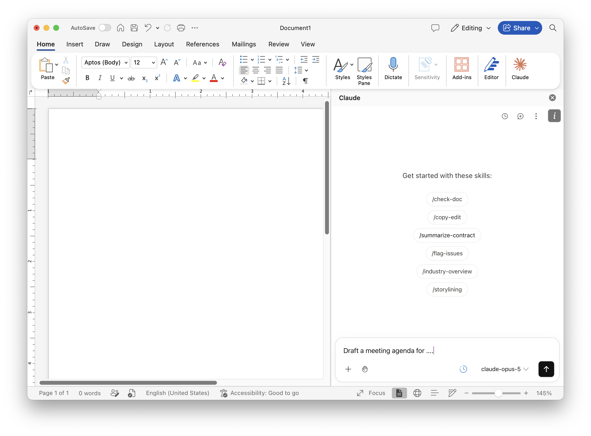

# Using Claude for Microsoft 365 with AI Assistant

**Claude for Microsoft 365** is Anthropic's add-in for **Word**, **Excel**, and **PowerPoint**. It adds a Claude sidebar to these apps so you can draft, revise, and review documents, spreadsheets, and slides within the app. Configure it to connect through the AI Assistant gateway using your API key instead of signing in with an Anthropic account.

## Prerequisites

1. [Obtain your AI Assistant API key](api-key.md).
2. Access to Word, Excel, or PowerPoint on desktop (Windows or Mac) or on the web.
3. Your University of Arizona Microsoft account to sign in to Microsoft Marketplace and acquire the add-in.

## 1. Install the add-in

1. Go to the [Claude for Microsoft 365 add-in](https://marketplace.microsoft.com/en-us/product/wa200010725) on Microsoft Marketplace (by **Claude by Anthropic for Office**) and click **Get it now**.

    {: style="width:100%; height:auto;"}

2. Sign in to Microsoft Marketplace with your University of Arizona Microsoft account.

    {: style="width:100%; height:auto;"}

3. On the launch page, click **Open in Excel**, **Open in Word**, or **Open in PowerPoint**. The add-in is now installed for your University of Arizona Microsoft account and available the next time you open any of these apps.

    {: style="width:100%; height:auto;"}

## 2. Open Claude in the app

### Desktop (Windows or Mac)

Claude normally appears as a button on the **Home** ribbon. Click it to open the Claude sidebar.

If a context-specific ribbon tab (such as **Table**) is active and hides the **Claude** button, click the **...** (More Commands) button near the right edge of the ribbon and select **Claude** from the **Claude** group at the bottom of the menu.

{: style="width:100%; height:auto;"}

### Web (Word, Excel, or PowerPoint on the web)

The web apps don't show a Claude button on the ribbon. Use the search bar at the top of the window, type `claude`, and select **Claude for Microsoft 365** under **Add-ins**.

{: style="width:100%; height:auto;"}

## 3. Connect to AI Assistant

The first time you open the Claude sidebar, it prompts you to sign in.

{: style="width:100%; height:auto;"}

1. Click **Cloud provider or gateway** instead of **Log in** or **Sign up**.
2. On the **Connect another way** screen, keep the **Gateway** tab selected.
3. Set **Gateway URL** to `https://ai-assistant.responsibleai.arizona.edu`.
4. Set **Token** to your AI Assistant API key.
5. Click **Continue**.

    {: style="width:100%; height:auto;"}

If your workspace shows a different AI Assistant base URL, use it for **Gateway URL** instead.

## 4. Start using Claude

Once connected, the sidebar shows a prompt box and a set of starter skills, such as `/check-doc`, `/copy-edit`, `/summarize-contract`, `/flag-issues`, `/industry-overview`, and `/storylining`.

{: style="width:100%; height:auto;"}

Type a prompt, or click one of the starter skills, then press **Enter** or click the send button.

## Update your API key

Open the Claude sidebar's settings, disconnect the current gateway connection, and repeat [Connect to AI Assistant](#3-connect-to-ai-assistant) with your new AI Assistant API key.
